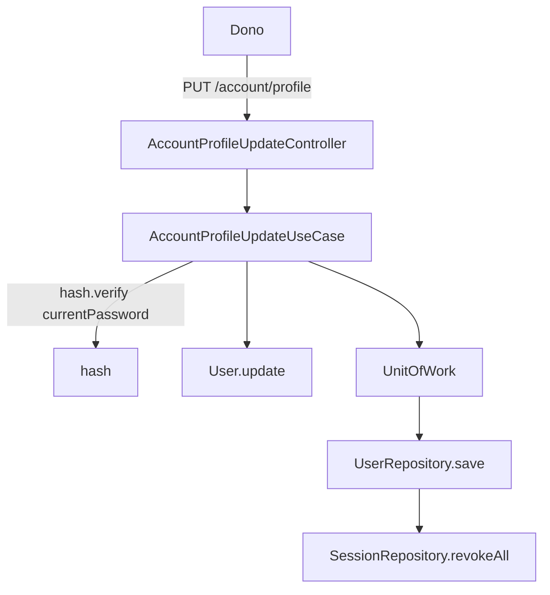

# Conta do dono Design

**Spec**: `.specs/features/conta/spec.md`
**Status**: Draft

---

## Architecture Overview

Módulo `account/profile/{show,update}` (`_standards/architecture.md` §3), sessão obrigatória, sem `role`. A
entidade `User` (ponto de extensão do kit) ganha `update(patch)` e `credentials()`: troca de e-mail ou de
senha marca `revokeSessions`. O `UserRepository.save` grava a linha, o hash novo e chama
`SessionRepository.revokeAll(userId)` dentro da mesma `UnitOfWork`. O controller limpa os cookies quando
houve revogação.

## Code Reuse Analysis

### Existing Components to Leverage

| Component | Location | How to Use |
| --------- | -------- | ---------- |
| `User`, `UserRepository` (+ Lucid, memória) | kit, pontos de extensão | `update`, `credentials`, `save` com revogação |
| `SessionRepository.revokeAll` | kit | derruba as sessões na transação corrente |
| `UnitOfWork` | kit | uma transação para linha e tokens |
| `SessionCookie` | `features/authentication/_shared.session-cookie.ts` | limpar cookies na resposta |
| `Rule.password()`, `Rule.email()` | `shared/src/validator.ts` | campos do update (`Rule.partial`, #386) |
| `ActorSchema` | shared | `actor` no payload do use-case |

### Integration Points

| System | Integration Method |
| ------ | ------------------ |
| `start/routes.ts` | grupo `account` com `auth()` |
| `start/limiter.ts` | `accountThrottle`: 5 por 15 minutos por usuário |
| `resources/lang/*/account.json` | `account.email_in_use`, `account.current_password_invalid` |

## Components

- `shared/src/validators/account/profile.validator.ts` (Zod) e `backend/app/validators/account/profile.validator.ts` (VineJS), mesmo nome e campos: `name?`, `email?`, `password?`, `currentPassword`.
- `shared/src/responses/account/profile.response.ts`: `AccountProfileShowResponse` (id, nome, e-mail, papel).
- `features/account/profile/{show,update}` + `profile.presenter.ts` + `_shared.profile-refusal.ts`.

## Error Handling Strategy

| Error Scenario | Handling | User Impact |
| -------------- | -------- | ----------- |
| senha atual errada | 422 em `currentPassword` | não muda nada |
| e-mail em uso | 409 `EMAIL_IN_USE` (unique do banco por `LucidMapping.unlessUnique`) | não muda nada |
| falha no save | rollback da `UnitOfWork` | senha e sessões antigas valem |

## Risks & Concerns

| Risk | Mitigation |
| ---- | ---------- |
| revogar fora da transação deixaria sessão viva com senha nova | `revokeAll` dentro da `UnitOfWork`, e2e prova 200 -> 401 |
| corrida de duas trocas | o segundo save roda depois do primeiro commit; ambos revogam |
