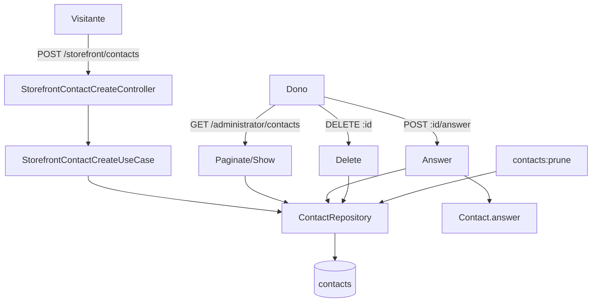

# Contato Design

**Spec**: `.specs/features/contato/spec.md`
**Status**: Approved

---

## Architecture Overview

Dois módulos da árvore da casa (`_standards/architecture.md` §3): `storefront/contacts/create` (público,
sem sessão) e `administrator/contacts/{paginate,show,answer,delete}` (sessão com papel de staff). A regra
de transição mora na entidade `Contact`; o use-case traduz o fato em `left(HTTPException)` pelo refusal
do recurso (`domain.md` §2). A persistência passa pelo `ContactRepository` (contrato, Lucid e memória). A
guarda de 12 meses é o comando `contacts:prune`, disparado pelo agendador do ambiente.



## Code Reuse Analysis

### Existing Components to Leverage

| Component | Location | How to Use |
| --------- | -------- | ---------- |
| `Rule`, `PageValidator`, `z` | `shared/src/validator.ts` | campos do formulário e da listagem (#386) |
| `LOCALES` | `shared/src/enums/locale.ts` | idioma do contato |
| `ResponseRule.paginated` | `shared/src/responses/envelope.ts` | resposta da listagem |
| `core/validator.ts` | backend | o `vine` configurado do par VineJS |
| `_shared.refusal.base.ts` | `app/features/` | `_shared.contact-refusal.ts` |
| `UnitOfWork`, `Clock`, `IdGenerator` | kit | transação, instante do `answered_at`, id |
| `LucidMapping.page`, `PageCriteria`, `MemoryRows` | kit | listagem nas duas implementações |
| `storages-prune.command.ts` | kit | forma do comando de expurgo |
| `QueryCount` (`tests/query-count-fixtures.ts`) | kit | queries da listagem travadas (#382) |

### Integration Points

| System | Integration Method |
| ------ | ------------------ |
| `start/routes.ts` | grupos `storefront` (público) e `administrator` (`auth` + `role`) |
| `start/limiter.ts` | `contactThrottle`: 5 por hora por IP |
| `providers/repository.provider.ts` | bind `ContactRepository` -> `ContactLucidRepository` |
| `config/openapi.ts`, `core/openapi/response.ts` | tags e respostas do contrato |
| `resources/lang/{pt-BR,en,es}/contacts.json` | mensagens de negócio |

## Components

### Contact (entidade)

- **Purpose**: o contato e a transição pendente -> respondido.
- **Location**: `backend/app/domain/contact/contact.entity.ts`, `contact.errors.ts`
- **Interfaces**: `Contact.create(input)`, `Contact.restore(props)`, `answer(at): Either<ContactAlreadyAnswered, Contact>`, `snapshot()`
- **Reuses**: forma de `domain/storage/storage.entity.ts`

### ContactRepository

- **Purpose**: persistência por intenção.
- **Location**: `backend/app/repositories/contact/contact.{repository,lucid.repository,memory.repository}.ts`
- **Interfaces**: `create(contact)`, `findById(id)`, `paginate(criteria)`, `save(contact)` com `where answered_at is null` (corrida de dois `answer`), `delete(contact)`, `deleteCreatedBefore(cutoff): Promise<number>`, `countCreatedBefore(cutoff)`

### Use-cases e controllers

- `storefront/contacts/create`: honeypot -> `right(null)` sem gravar; senão cria.
- `administrator/contacts/paginate`, `show`, `answer`, `delete`.
- `commands/contacts-prune.command.ts` chama `AdministratorContactPruneUseCase` (`features/administrator/contacts/prune/prune.use-case.ts`, sem controller), como o `storages:prune` chama o use-case de delete.

## Data Models

### contacts

```sql
id uuid pk default gen_random_uuid()
name varchar(120) not null
email varchar(254) not null
message text not null            -- até 5000, cobrado no validator
locale enum('pt-BR','en','es') not null
answered_at timestamp null
created_at timestamp not null
updated_at timestamp null
index (created_at), index (answered_at)
```

Sem `deleted_at`: o contato não vai para lixeira; o apagar é de vez (pedido LGPD e expurgo).

## Error Handling Strategy

| Error Scenario | Handling | User Impact |
| -------------- | -------- | ----------- |
| corpo inválido | 422 do validator | `errors` por campo |
| honeypot preenchido | 201 sem gravar | nenhum |
| limite por IP | 429 do limiter | `TOO_MANY_REQUESTS` |
| id inexistente | 404 `CONTACT_NOT_FOUND` | chave `contacts.not_found` |
| já respondido | 409 `CONTACT_ALREADY_ANSWERED` | chave `contacts.already_answered` |
| falha de banco | 500 `<MODULE>_<RESOURCE>_<ACTION>_ERROR` | log sem dado pessoal |

## Risks & Concerns

| Risk | Mitigation |
| ---- | ---------- |
| Aviso por e-mail exigiria Redis e SMTP no Coolify | fora desta entrega, decisão do dono |
| Apagar à mão é irreversível | só o staff, por `DELETE`, 404 igual para inexistente |
| Spam acima do limite por IP | honeypot + limiter; captcha fica fora |
