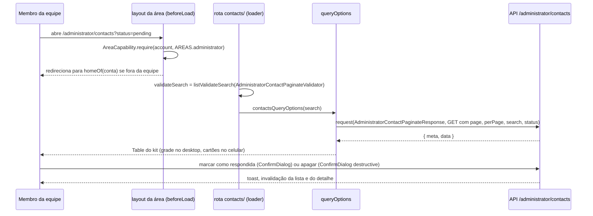

# Painel de contatos Design

**Spec**: `.specs/features/painel-contatos/spec.md`
**Status**: Draft. Espera as respostas Q1 a Q5 e a leva do kit com entrar, layout `_private` e shell; o desenho abaixo segue as recomendações das perguntas.

---

## Architecture Overview

A caixa de entrada é uma área do painel. A sessão (`_private/layout.tsx`), a tela de entrar e o shell vêm do kit e não são desenhados aqui. O projeto entrega a área `administrator`, a rota da lista, a rota do detalhe e as ações. As regras que mudam o que a pessoa vê (busca, filtro de status, ordem, paginação, transição pendente para respondida) rodam no backend; o frontend só leva os parâmetros da URL e mostra o que a API devolve.



## Code Reuse

| Peça                                                                                                                                                      | De onde                                                                                              | Uso aqui                                                                                                                   |
| --------------------------------------------------------------------------------------------------------------------------------------------------------- | ---------------------------------------------------------------------------------------------------- | -------------------------------------------------------------------------------------------------------------------------- |
| `Table` e peças (`TableHeader`, `TableToolbar`, `TableSearch`, `TableContent`, `TableGrid`, `TableEmpty`, `TablePagination`, `TableSkeleton`, `useTable`) | kit `components/common/table/`, religado pelo sync `--sem=pix --com=table` na régua com a #48 (#481) | lista; `to="/administrator/contacts/"` com a barra final (`frontend.md` §2.1); sem `TableTrashToggle` (não há lixeira)     |
| `listValidateSearch`                                                                                                                                      | kit `lib/list-search.ts`                                                                             | `-search.ts` da rota, sobre `AdministratorContactPaginateValidator`; sem `sort`, `direction` e `trashed` (suportado, #445) |
| `request()`, `send()`, `HTTPError`                                                                                                                        | kit `integrations/tanstack-query/http.ts`                                                            | leitura pelo schema `...Response` do shared; `send()` para o 204 do apagar; erro comparado por `code`                      |
| `useInvalidate`                                                                                                                                           | kit `integrations/tanstack-query/invalidate.ts`                                                      | depois de marcar e de apagar                                                                                               |
| `AreaCapability`                                                                                                                                          | kit `lib/area-capability.ts`                                                                         | `beforeLoad` do layout da área                                                                                             |
| `ConfirmDialog` e `createConfirmHandle`                                                                                                                   | kit `components/common/confirm-dialog/`                                                              | marcar como respondida (`destructive={false}`) e apagar (`destructive`)                                                    |
| `RowActions`                                                                                                                                              | kit `components/common/row-actions/`                                                                 | ações da linha; os diálogos vão em `dialogs=`, irmãos do menu                                                              |
| `FilterSegmented`                                                                                                                                         | kit `components/common/filters/`                                                                     | filtro de status com três segmentos: todos, pendentes, respondidas                                                         |
| `EmptyState`, `NotFoundPage`, `LoadError`                                                                                                                 | kit                                                                                                  | estados vazios e de erro; `TableEmpty` escolhe `first-use` ou `filtered`                                                   |
| `loadOrNotFound`                                                                                                                                          | kit `lib/load-or-not-found.ts`                                                                       | 404 do detalhe vira `notFound()`                                                                                           |
| Entrar, `_private/layout.tsx`, shell                                                                                                                      | kit, próxima leva                                                                                    | não entram nesta PR                                                                                                        |

## Components

Árvore pela régua (`frontend.md` §1.1, §1.2, §2.1, §3.4):

```
frontend/src/
├── lib/areas.ts                                   # AREAS.administrator: { tenant: STAFF_USER_ROLES }
├── hooks/tanstack-query/_query-keys.ts            # queryKeys.administrator.contacts.{all, lists, list, details, detail}
├── integrations/tanstack-query/
│   ├── queries/administrator.ts                   # contactsQueryOptions(search), contactQueryOptions(id)
│   ├── mutations/administrator.ts                 # useAnswerContact, useDeleteContact (hooks finos)
│   └── invalidate.ts                              # dependentes da caixa de entrada
└── routes/_private/administrator/
    ├── layout.tsx                                 # beforeLoad: AreaCapability.require(context.account, AREAS.administrator)
    └── contacts/
        ├── -search.ts                             # validateSearch e toContactsParams
        ├── index.tsx / index.lazy.tsx             # lista: validateSearch, loaderDeps, loader, pending, head
        ├── $id/index.tsx / $id/index.lazy.tsx     # detalhe: loader com loadOrNotFound, head
        └── -components/
            ├── contacts-table.tsx                 # Table + useTable + colunas
            ├── contacts-columns.tsx               # colunas com columnDef.meta.label
            ├── contacts-status-filter.tsx         # FilterSegmented ligado ao status da URL
            ├── contact-row-actions.tsx            # RowActions com marcar e apagar
            ├── contact-detail.tsx                 # tela do detalhe
            ├── answer-contact-dialog.tsx          # ConfirmDialog destructive={false}
            └── delete-contact-dialog.tsx          # ConfirmDialog destructive
```

Comportamento por peça:

- **Lista (`index.tsx`)**: `loaderDeps` lê `page`, `perPage`, `search` e `status`; o `loader` faz `prefetch` de `contactsQueryOptions(search)`. A tela usa `useQuery` com `keepPreviousData` e passa `isPlaceholderData`, `isError` e `onRetry` à `Table`. A linha leva ao detalhe por `onRowClick` com `navigate({ to: '/administrator/contacts/$id', params: { id } })`; no celular o título do cartão é o botão esticado do kit.
- **Filtro de status**: segmento "todos" tira `status` da URL; "pendentes" e "respondidas" põem `pending` e `answered`. Toda navegação da tabela é `from: to` + `to: '.'` + `search: (prev) => ({ ...prev, status, page: undefined })` (#445).
- **Detalhe (`$id/index.tsx`)**: `loader` com `loadOrNotFound(contactQueryOptions(id))`; a tela usa `useSuspenseQuery`. Mostra nome, e-mail, idioma, mensagem como texto puro com quebras preservadas (`whitespace-pre-wrap`), recebida em e status. "Responder por e-mail" é `<a href="mailto:...">` com `buttonVariants` (#440). Voltar para a lista leva a busca anterior.
- **Marcar como respondida**: `useAnswerContact` chama `request(AdministratorContactShowResponse, api.post('/administrator/contacts/:id/answer'))`. Quem chama confirma pelo `ConfirmDialog` (`destructive={false}`), mostra toast curto e invalida a lista e o detalhe. `HTTPError` com `code === 'CONTACT_ALREADY_ANSWERED'` dá aviso e recarrega o detalhe. A ação só aparece quando `answeredAt` é nulo.
- **Apagar**: `useDeleteContact` usa `send(api.delete('/administrator/contacts/:id'))`. `ConfirmDialog` destructive com texto de exclusão definitiva; sem otimista (`frontend.md` §3, exclusão espera o servidor). No sucesso: toast, invalidação e, quando vem do detalhe, volta à lista. `code === 'CONTACT_NOT_FOUND'` dá aviso e atualiza a lista.

## Data Models

Sem modelo novo: o frontend lê os tipos do shared (`z.output` dos schemas `AdministratorContactShowResponse`, `AdministratorContactPaginateResponse` e `AdministratorContactPaginateValidator`). Mensagens novas em `messages/<locale>.json` (pt-BR, en, es), fora de `kit_*`, na área `administrator_contacts_*`.

## Risks & Concerns

| Concern                                                                                                                                                           | Mitigation                                                                                                                |
| ----------------------------------------------------------------------------------------------------------------------------------------------------------------- | ------------------------------------------------------------------------------------------------------------------------- |
| `RowActions` não exporta item genérico de confirmação (só arquivar, desarquivar e apagar), e o `RowActionsDelete` supõe registro arquivado (409 `*_NOT_ARCHIVED`) | levar à regente como lacuna do kit antes da implementação; não escrever item próprio dentro de `components/common`        |
| `FilterSegmented` não desliga o ativo; "todos" precisa ser um segmento explícito                                                                                  | três segmentos com "todos" sem `status` na URL; confirmar com a regente que a peça é a certa para três opções             |
| Entrar, layout `_private` e shell ainda não existem no kit                                                                                                        | a implementação começa depois da leva; o layout da área depende do `context.account` que o `_private` do kit vai entregar |
| `playwright.config` da leva 10C cria contas pelo `auth.setup` (backend no ar)                                                                                     | o E2E da caixa de entrada roda com o backend local e as contas do `e2e:accounts`                                          |
| Códigos `CONTACT_*` não estão no `HTTPErrorCode` do kit                                                                                                           | comparar `error.code` com o literal do contrato, que o shared declara como `string` no envelope                           |
| Ordem fixa sem cabeçalho ordenável                                                                                                                                | colunas sem `enableSorting`; mudança de ordem passa pela shared                                                           |
