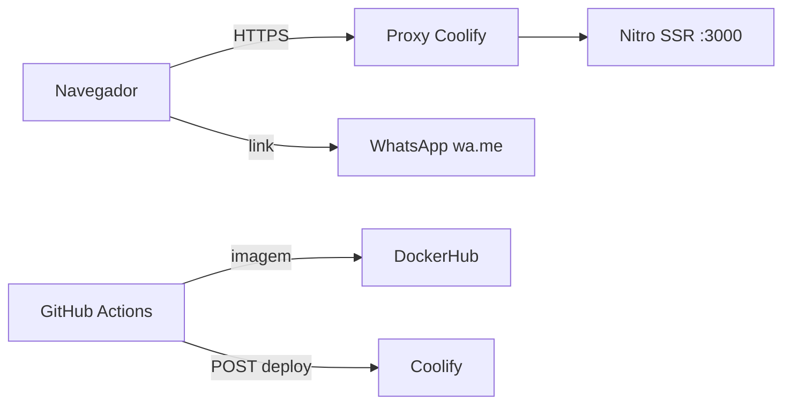

# Segurança

**Maiyu** · como avisar de uma falha, o que se protege, de quem, e como

> O modelo de ameaças (§2) é ancorado em evidência: cada fronteira, superfície e abuso aponta um
> caminho do repositório. Revisado quando muda fronteira: rota pública nova, integração, upload,
> papel novo (`_standards/documentation.md` §5). Segredo encontrado no caminho é redigido aqui,
> nunca copiado.

## 1. Como reportar uma vulnerabilidade

Não abra issue pública. Escreva para `contato@maiyu.com` com os passos para reproduzir. O prazo de
resposta e um endereço dedicado de segurança estão pendentes do dono (`PRD.md` §8).

## 2. Modelo de ameaças

### 2.1 Escopo e premissas

- Dentro: o `frontend/` (SSR em Nitro), a imagem Docker, o pipeline de deploy no GitHub Actions e no Coolify.
- Fora: a infraestrutura do Coolify e do DockerHub, e os sites dos clientes linkados no portfólio.
- Premissas: TLS terminado no proxy do Coolify. Não há banco, API, login nem upload. Runtime de produção se separa de CI e de desenvolvimento.

### 2.2 Componentes, fluxos e fronteiras de confiança

| Fronteira | Entre | O que a protege | Evidência |
|---|---|---|---|
| internet para o SSR | navegador e Nitro | TLS no proxy; rotas só de leitura | `frontend/src/routes/` |
| CI para o Coolify | GitHub Actions e Coolify | `COOLIFY_TOKEN` em secret do repositório | `.github/workflows/main-deploy-coolify.yml` |
| CI para o DockerHub | GitHub Actions e DockerHub | `DOCKERHUB_TOKEN` em secret | `.github/workflows/main-docker-frontend.yml` |

### 2.3 Ativos

| Ativo | Por quê importa | C / I / D | Onde fica | Quem acessa |
|---|---|---|---|---|
| `COOLIFY_TOKEN`, `DOCKERHUB_TOKEN` | publicar código no ar | C, I | secrets do GitHub | o dono e o workflow |
| Conteúdo do site | reputação e posicionamento da Maiyu | I, D | repositório e imagem | o dono |
| Contatos públicos (e-mail, telefone, endereço) | já são públicos | I | `frontend/src/lib/site.ts` | qualquer visitante |

### 2.4 Atacante

| Pode | Não pode (premissa) |
|---|---|
| chamar qualquer rota pública, enviar corpo arbitrário aos formulários | ler o código-fonte privado ou os secrets |
| abrir PR de fork (sem acesso a secrets) | interceptar TLS |

### 2.5 Superfícies

| Superfície | Como chega | Fronteira | Evidência |
|---|---|---|---|
| páginas SSR | `GET` em `/`, `/portfolio`, `/blog`, `/career`, `/contact` | internet para o SSR | `frontend/src/routes/_public/` |
| filtro do diário | `?category=` | internet para o SSR | `frontend/src/lib/blog-search.ts` |
| formulários | validação no cliente; nada é enviado | cliente | `frontend/src/routes/_public/-components/contact-form.tsx` |
| `/health-check`, `/sitemap.xml` | `GET` | internet para o SSR | `frontend/src/routes/health-check.ts` |
| deploy | `POST` ao Coolify | CI para o Coolify | `.github/workflows/main-deploy-coolify.yml` |

### 2.6 Abusos priorizados

| Id | Abuso | Probabilidade | Impacto | Prioridade | Mitigação | Evidência |
|---|---|---|---|---|---|---|
| TM-001 | valor arbitrário em `?category=` | alta | baixo | baixa | valor fora da lista cai para "tudo" | `frontend/src/lib/blog-search.test.ts` |
| TM-002 | injeção por texto de registro no JSON-LD | baixa | médio | média | JSON-LD montado por objeto e serializado em um ponto, com `<` escapado como `\u003c` | `frontend/src/lib/structured-data.test.ts` |
| TM-003 | vazamento do `COOLIFY_TOKEN` por log de CI | baixa | alto | média | token só em `env` do passo, não impresso | `.github/workflows/main-deploy-coolify.yml` |
| TM-004 | dependência com CVE | média | médio | média | versões recentes; lockfile; `pnpm install --frozen-lockfile` no CI | `.github/workflows/ci.yml` |

### 2.7 Calibragem de criticidade

Crítico: alguém publicar código no ar sem ser o dono (token de deploy). Alto: o site servir conteúdo
trocado. Médio: indisponibilidade prolongada. Baixo: enumeração de conteúdo público.

### 2.8 Para revisão manual

- Qualquer endpoint novo, incluindo o futuro envio dos formulários (`DECISIONS.md` #7), reabre este modelo.
- Cabeçalhos de segurança e CSP: não coberto por teste; conferir no proxy do Coolify.

## 3. Autenticação e sessão

Não se aplica: o site não tem login nem sessão.

## 4. Autorização

Não se aplica: todas as rotas são públicas e de leitura. Perfis: nenhum.

## 5. Entrada e saída

- Os formulários validam no cliente com VineJS (`frontend/src/lib/validator.ts`), com teto de tamanho por campo.
- Não há upload.
- Texto de registro é renderizado pelo React, que escapa por padrão; JSON-LD sai de objeto, nunca de string concatenada, e o `jsonLdScript` escapa `<` como `\u003c` (`_standards/frontend.md` §9.7): sem isso, um `</script>` num campo de registro fecharia a tag antes da hora.

## 6. Segredos

- O código não lê segredo. Os de pipeline ficam em secrets do repositório (`ENV.md` §3).
- Rotação: quem rotaciona é o dono, trocando o secret no GitHub e o token no Coolify ou DockerHub. Calendário: não definido.

## 7. Dependências

- Versão mais nova publicada (`_standards/tooling.md` §0); CVE corrigido assim que sai.
- `pnpm install --frozen-lockfile` no CI. Varredura automática (Dependabot, `pnpm audit`): não configurada.

## 8. Dados pessoais (LGPD)

| Dado | Finalidade | Base legal | Retenção | Exclusão |
|---|---|---|---|---|
| nome, e-mail e mensagem digitados nos formulários | nenhuma: o site não envia nem guarda | Não se aplica: sem tratamento | não há | não há |

O contato por e-mail e WhatsApp acontece fora do site, nos serviços do próprio visitante.

## 9. Checklist de revisão

- [ ] Rota nova tem auth e policy quando houver login; rota pública nova, integração, upload ou papel atualizou o §2.
- [ ] Nenhum segredo no diff.
- [ ] Entrada validada; JSON-LD por objeto e serializado pelo `jsonLdScript`, que escapa `<`.
- [ ] Log sem dado pessoal.
