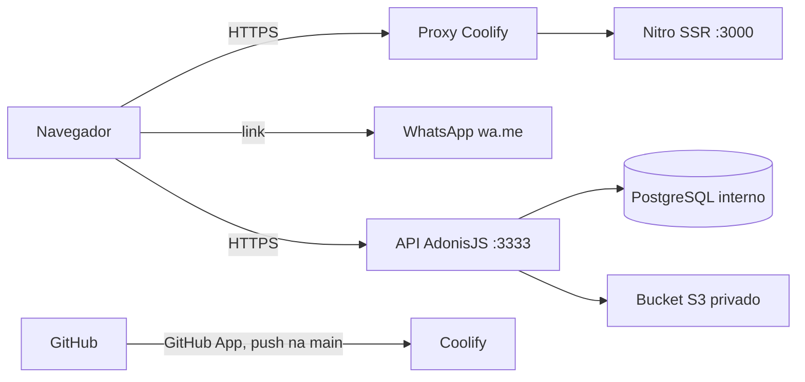

# Segurança

**Maiyu** · como avisar de uma falha, o que se protege, de quem, e como

> O modelo de ameaças (§2) é ancorado em evidência: cada fronteira, superfície e abuso aponta um
> caminho do repositório. Revisado quando muda fronteira: rota pública nova, integração, upload,
> papel novo (`_standards/documentation.md` §5). Segredo encontrado no caminho é redigido aqui,
> nunca copiado.

## 1. Como reportar uma vulnerabilidade

Não abra issue pública. Escreva para `contato@maiyu.com.br` com os passos para reproduzir. O prazo de
resposta e um endereço dedicado de segurança estão pendentes do dono (`PRD.md` §8).

## 2. Modelo de ameaças

### 2.1 Escopo e premissas

- Dentro: o `frontend/` (SSR em Nitro), o `backend/` (API AdonisJS em `api.maiyu.com.br`, com a sessão do dono e os anexos), as imagens Docker e o deploy do Coolify a partir do Git.
- Fora: a infraestrutura do Coolify e do provedor do bucket, e os sites dos clientes linkados no portfólio.
- Premissas: TLS terminado no proxy do Coolify. O site público não faz login, não grava dado e não envia upload; a API tem login só do dono, e o frontend ainda não a chama em tempo de execução. Runtime de produção se separa de desenvolvimento.

### 2.2 Componentes, fluxos e fronteiras de confiança

| Fronteira | Entre | O que a protege | Evidência |
|---|---|---|---|
| internet para o SSR | navegador e Nitro | TLS no proxy; rotas só de leitura | `frontend/src/routes/` |
| internet para a API | navegador e API | TLS no proxy; CORS por `CORS_ORIGINS`; cookie `httpOnly`; checagem de origem em toda escrita | `backend/config/`, `backend/app/features/authentication/` |
| API para o banco e o bucket | API, Postgres e S3 | Postgres só na rede interna; bucket privado com URL assinada | `backend/app/services/storage/`, `ARCHITECTURE.md` §9.1 |
| Git para o Coolify | GitHub e Coolify | GitHub App do Coolify com acesso só ao repositório; o repositório não tem secret de deploy | `ARCHITECTURE.md` §9.1 |

### 2.3 Ativos

| Ativo | Por quê importa | C / I / D | Onde fica | Quem acessa |
|---|---|---|---|---|
| Credencial do dono da API | publicar e apagar anexos, ler a conta | C, I | hash Argon2 no Postgres; senha inicial só no painel (`SEED_OWNER_PASSWORD`) | o dono |
| Acesso ao painel do Coolify e ao GitHub App | publicar código no ar | C, I | conta do dono | o dono |
| Conteúdo do site | reputação e posicionamento da Maiyu | I, D | repositório e imagem | o dono |
| Contatos públicos (e-mail, telefone, endereço) | já são públicos | I | `frontend/src/lib/site.ts` | qualquer visitante |

### 2.4 Atacante

| Pode | Não pode (premissa) |
|---|---|
| chamar qualquer rota pública do site e da API, enviar corpo arbitrário à API | ler o código-fonte privado ou os valores do painel do Coolify |
| abrir PR de fork (sem acesso a secrets) | interceptar TLS |

### 2.5 Superfícies

| Superfície | Como chega | Fronteira | Evidência |
|---|---|---|---|
| páginas SSR | `GET` em `/`, `/portfolio`, `/blog`, `/career`, `/contact` | internet para o SSR | `frontend/src/routes/_public/` |
| filtro do diário | `?category=` | internet para o SSR | `frontend/src/lib/blog-search.ts` |
| aviso de contato | sem formulário e sem envio (`DECISIONS.md` #17); só links `mailto:` e WhatsApp | cliente | `frontend/src/routes/_public/-components/channels-notice.tsx` |
| `/health-check`, `/sitemap.xml` | `GET` | internet para o SSR | `frontend/src/routes/health-check.ts` |
| sessão do dono | `POST /authentication/{sign-in,sign-out,refresh}` | internet para a API | `backend/app/features/authentication/sessions` |
| anexos | `/storages`, só com sessão | internet para a API | `backend/app/features/storages/files` |
| deploy | push na `main` e *Auto Deploy* do Coolify | Git para o Coolify | `ARCHITECTURE.md` §9.1 |

### 2.6 Abusos priorizados

| Id | Abuso | Probabilidade | Impacto | Prioridade | Mitigação | Evidência |
|---|---|---|---|---|---|---|
| TM-001 | valor arbitrário em `?category=` | alta | baixo | baixa | valor fora da lista cai para "tudo" | `frontend/src/lib/blog-search.test.ts` |
| TM-002 | injeção por texto de registro no JSON-LD | baixa | médio | média | JSON-LD montado por objeto e serializado em um ponto, com `<` escapado como `\u003c` | `frontend/src/lib/structured-data.test.ts` |
| TM-003 | força bruta ou reuso de token na sessão do dono | média | alto | alta | limite de taxa nomeado no Postgres (`rate_limits`), Argon2, refresh rotativo com detecção de reuso (`consumed_refresh_tokens`) | `backend/start/limiter.ts` |
| TM-004 | dependência com CVE | média | médio | média | versões recentes; lockfile; `pnpm install --frozen-lockfile` no build do Docker | `pnpm-lock.yaml` |

### 2.7 Calibragem de criticidade

Crítico: alguém publicar código no ar ou entrar na conta do dono sem ser o dono. Alto: o site servir conteúdo
trocado. Médio: indisponibilidade prolongada. Baixo: enumeração de conteúdo público.

### 2.8 Para revisão manual

- Qualquer endpoint novo, incluindo o futuro formulário de contato (`DECISIONS.md` #17), reabre este modelo.
- Cabeçalhos de segurança: a montagem da CSP tem teste (`frontend/src/lib/security-headers.test.ts`), a aplicação no `server.ts` não; conferir com `curl -sI` depois do deploy (§5).

## 3. Autenticação e sessão

O site não tem login nem sessão. A API tem uma conta só, a do dono: sessão por par de tokens opacos em
cookie `httpOnly`, refresh rotativo e checagem de origem em toda escrita (`ARCHITECTURE.md` §8). Mudar
senha, e-mail, papel ou status apaga as sessões da conta.

## 4. Autorização

As rotas do site são públicas e de leitura. Na API, `/storages` exige sessão e a documentação
(`/openapi.json`, `/documentation`) exige papel de staff. Perfis: `ADMINISTRATOR` (o dono) e `MEMBER`,
que nenhuma rota cria hoje (`shared/src/enums/user-role.ts`).

## 5. Entrada e saída

- O site não tem formulário nem campo de entrada: a única entrada é o `?category=` do diário, validada à mão em `lib/blog-search.ts`. A API valida a requisição com VineJS (`shared/` e validators do backend).
- Upload só na API, multipart assinado e com sessão; o site não envia arquivo.
- Texto de registro é renderizado pelo React, que escapa por padrão; JSON-LD sai de objeto, nunca de string concatenada, e o `jsonLd` do kit escapa `<` como `\u003c` (`_standards/frontend.md` §9.7): sem isso, um `</script>` num campo de registro fecharia a tag antes da hora.

### 5.1 Cabeçalhos de segurança

O `frontend/src/server.ts` aplica em toda resposta que passa pelo SSR os cabeçalhos de
`frontend/src/lib/security-headers.ts`, arquivo do kit (`_standards/frontend.md` §3.3):

| Cabeçalho | Valor | Por quê |
|---|---|---|
| `Content-Security-Policy` | `default-src 'self'`; `script-src` com `'self'` e nonce por resposta; `style-src` com `'unsafe-inline'`; `img-src`, `connect-src` e `font-src` do kit; `frame-ancestors 'none'`; `base-uri 'self'`; `form-action 'self'`; `object-src 'none'` | `frame-ancestors` impede clickjacking; o nonce autoriza os scripts de hidratação do Start sem `unsafe-inline` em script; a origem da API e a do bucket entram por `VITE_API_URL` e `STORAGE_PUBLIC_URL` |
| `X-Content-Type-Options` | `nosniff` | o navegador não adivinha tipo de arquivo |
| `Referrer-Policy` | `strict-origin-when-cross-origin` | link de saída leva só a origem |
| `Strict-Transport-Security` | `max-age=31536000; includeSubDomains` | sem `preload`, que não se desfaz |
| `X-Robots-Tag` | `noindex, nofollow` | só quando `SITE_ENV` não é `production`, lida por requisição (`ENV.md`) |

Pendências conhecidas:

- O que o Nitro serve direto de `public/` e de `/assets/` não passa pelo `server.ts` e sai sem esses
  cabeçalhos, Ficam para outro item. O `robots.txt` é rota do kit e responde `Disallow: /` fora de produção.

## 6. Segredos

- O site não lê segredo. Os da API ficam nas variáveis de runtime do recurso no Coolify, nunca no repositório (`ENV.md` §3). O repositório não tem secret de deploy (`_standards/DECISIONS.md` #368).
- Rotação: quem rotaciona é o dono, trocando o valor no painel do Coolify (`APP_KEY`, `STORAGE_SECRET`, senha do banco). Calendário: não definido.

## 7. Dependências

- Versão mais nova publicada (`_standards/tooling.md` §0); CVE corrigido assim que sai.
- `pnpm install --frozen-lockfile` no build do Docker. Varredura automática (Dependabot, `pnpm audit`): pendente da frente de infra (R4.3).

## 8. Dados pessoais (LGPD)

| Dado | Finalidade | Base legal | Retenção | Exclusão |
|---|---|---|---|---|
| e-mail, nome e hash da senha do dono, no `users` da API | acesso do dono | Não se aplica: dado do operador, não de titular externo | enquanto a conta existir | arquivar a conta apaga as sessões |
| nenhum dado de visitante: o site não tem formulário | nenhuma | Não se aplica: sem tratamento | não há | não há |

O contato por e-mail e WhatsApp acontece fora do site, nos serviços do próprio visitante.

## 9. Checklist de revisão

- [ ] Rota nova tem auth e policy quando houver login; rota pública nova, integração, upload ou papel atualizou o §2.
- [ ] Nenhum segredo no diff.
- [ ] Entrada validada; JSON-LD por objeto e serializado pelo `jsonLdScript`, que escapa `<`.
- [ ] Log sem dado pessoal.
